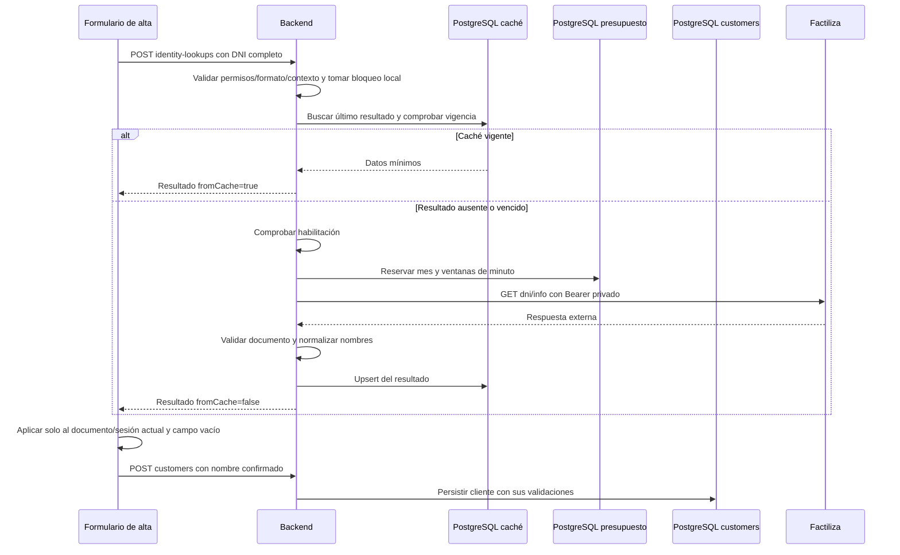

# Consulta de nombres por DNI mediante Factiliza

Documento técnico vigente del módulo Customers. Fecha: 12 de octubre de 2026.

## Propósito y alcance

Obtener nombres y apellidos asociados a un DNI para ayudar al alta de clientes. La consulta se resuelve mediante caché PostgreSQL o mediante Factiliza desde el backend. El operador revisa el nombre y puede corregirlo. Existe entrada manual ante fallos; CE y edición no realizan búsqueda automática.

La funcionalidad no verifica titularidad biométrica, vigencia documental, estado crediticio ni capacidad de pago. No utiliza OCR y no conecta directamente con una API oficial de RENIEC. Customer mantiene un nombre editable sin origen persistido por ficha; la caché no es un snapshot contractual.

## Componentes actuales

| Capa | Componente | Responsabilidad |
|---|---|---|
| Presentation | CustomerIdentityLookupController | Recibe JSON validado y devuelve DTO mínimo con no-store |
| Application | LookupCustomerIdentityUseCase / LookupCustomerIdentityService | Orquesta formato, contexto, coordinación, caché, presupuesto y proveedor |
| Application | IdentityLookupMapper | Interfaz MapStruct; factory default para entidad y respuesta generada |
| Domain | IdentityData | Valor normalizado; documento/nombres/proveedor válidos y nombre completo |
| Domain | IdentityDocumentCache | Resultado con instantes, vigencia y auditoría |
| Domain | IdentityDocumentCacheRepository | Lectura por DNI y upsert atómico de resultado |
| Domain | IdentityLookupProvider | Puerto de consulta externa |
| Domain | IdentityLookupPolicy | Habilitación de llamadas y duración de vigencia |
| Domain | IdentityLookupBudget | Reserva de intentos externos |
| Domain | IdentityLookupCoordinator | Serialización por franja dentro de una JVM |
| Infrastructure | FactilizaIdentityLookupProvider | Transporte/JSON/error externo a contrato interno |
| Infrastructure | PostgresIdentityLookupBudget | Reserva JDBC atómica para mes y ventanas de minuto |
| Infrastructure | IdentityLookupConfig / IdentityLookupProperties | Transporte fijo, binding y validación de parámetros |
| Shared/Security | Clock, CurrentUserProvider, CurrentBranchProvider | Tiempo y contexto del operador |
| Frontend | ModalNuevoCliente / CatalogFormDialog / useFormLookup | Captura, consulta opcional, estados y control de respuestas |



En el último paso, la persistencia de customers ocurre en PostgreSQL mediante su repositorio comercial; no es una actualización de identity_document_cache ni una llamada nueva al proveedor.

## Contrato interno

**Método y ruta:** POST /api/customers/identity-lookups.  
**Autenticación:** JWT del operador en Authorization: Bearer.  
**Autorización:** customers:write en ruta y caso de uso. El formulario requiere también customers:read para su página.  
**Contexto:** actor y sucursal proceden del principal autenticado.  
**Éxito:** 200, JSON directo sin envoltorio ApiResponse y Cache-Control: no-store.

Solicitud de ejemplo con un DNI sintético, no consultado:

```json
{"documentType":"DNI","documentNumber":"00000001"}
```

El request requiere tipo no nulo y número textual de ocho dígitos ASCII. No admite espacios. CE se rechaza en el caso de uso incluso si su número satisficiera el patrón de ocho dígitos. No se envían token externo, actor, branchId o proveedor.

```json
{
  "documentType": "DNI",
  "documentNumber": "00000001",
  "givenNames": "NOMBRES",
  "firstSurname": "UNO",
  "secondSurname": "DOS",
  "fullName": "NOMBRES UNO DOS",
  "provider": "FACTILIZA",
  "fromCache": false,
  "consultedAt": 1791817200.000000000,
  "expiresAt": 1794409200.000000000
}
```

| Campo | Significado |
|---|---|
| documentType | DNI, único tipo admitido en esta operación |
| documentNumber | Documento solicitado y validado contra el resultado externo |
| givenNames | Nombres normalizados; no es únicamente un primer nombre |
| firstSurname / secondSurname | Apellidos disponibles; pueden ser null |
| fullName | Nombres seguidos de apellidos presentes; máximo 150 caracteres |
| provider | FACTILIZA, incluso si la consulta actual se resuelve desde caché |
| fromCache | Si esta llamada reutilizó resultado vigente; no expresa verificación de titularidad |
| consultedAt | Instante de obtención del resultado, serializado actualmente como segundos Unix numéricos con fracción decimal; no fecha de actualización de la fuente externa |
| expiresAt | Fin de vigencia local serializado como segundos Unix numéricos con fracción decimal; posterior a consultedAt |

Guardar un cliente continúa utilizando POST /api/customers con fullName confirmado y sin indicador verified. La operación de alta recorta el número y exige ocho dígitos para DNI; sus reglas no convierten la consulta exitosa en obligatoria.

## Contrato externo implementado

GET https://api.factiliza.com/v1/dni/info/{dni}, sin punto final en la ruta. Cabeceras: Accept: application/json y Authorization: Bearer con el token privado del backend.

El adaptador utiliza status, success y los campos data.numero, data.nombres, data.apellido_paterno y data.apellido_materno. El formato externo data.nombre_completo no define el orden del nombre interno. No conserva dirección, sexo, nacimiento, ubigeo ni el cuerpo completo.

El transporte tiene destino HTTPS fijo y no sigue redirecciones. Se limita el cuerpo leído a 65,536 bytes; un exceso se rechaza. La respuesta debe ser JSON coherente, success verdadero y documento igual al solicitado. No se permiten nombres que excedan el límite interno mediante truncamiento.

No existen reintentos de red automáticos. El proveedor debe verificarse con una consulta autorizada después de configurar la cuenta. Las pruebas automatizadas usan un token sintético y contratos simulados.

## Estados y errores

| HTTP interno | Código | Origen y tratamiento |
|---|---|---|
| 400 | VALIDATION_ERROR | Bean Validation/JSON; no se ejecuta una consulta inválida |
| 400 | IDENTITY_DOCUMENT_INVALID | Tipo o documento rechazado por caso de uso, o alta DNI incorrecta |
| 401 | UNAUTHORIZED o contrato de autenticación correspondiente | Sesión interna ausente/inválida; no es credencial de Factiliza |
| 403 | FORBIDDEN | Permiso interno insuficiente |
| 404 | IDENTITY_NOT_FOUND | El adaptador recibió un 404 explícito |
| 409 | DATA_INTEGRITY_CONFLICT | Conflicto técnico de integridad traducido por GlobalExceptionHandler; no equivale a cliente duplicado |
| 429 | IDENTITY_RATE_LIMITED | Ventana de frecuencia, espera de coordinación o 429 externo |
| 502 | IDENTITY_PROVIDER_INVALID_RESPONSE | JSON/estado/estructura/documento/nombres/tamaño incoherentes |
| 503 | IDENTITY_LOOKUP_DISABLED | Se necesitaba proveedor y las llamadas externas están deshabilitadas |
| 503 | IDENTITY_QUOTA_EXHAUSTED | Presupuesto mensual local agotado |
| 503 | IDENTITY_PROVIDER_UNAVAILABLE | Rechazo/transporte externo o fallo de reserva; 400/401/402/403/5xx externos |
| 504 | IDENTITY_PROVIDER_TIMEOUT | Timeout de transporte o 408/504 externo |
| 500 | INTERNAL_ERROR | Fallo interno no controlado, conforme a GlobalExceptionHandler |

Con JacksonConfig actual, el timestamp de ApiError se serializa como un arreglo de cinco a siete enteros: año, mes, día, hora, minuto y, si corresponden, segundo y nanosegundo. No es un Instant ni un texto ISO con zona horaria. Esta entrega documenta la serialización existente y no agrega JsonFormat ni cambia ObjectMapper.

Los errores siguen ApiError, no el JSON crudo del proveedor. No se supone que un 400 genérico demuestre DNI inexistente o saldo agotado. Un 401/403 externo no debe cerrar la sesión del operador. La UI conserva mensajes específicos de identidad para 5xx, pero mantiene prioridad de 401/403 internos.

## Persistencia

### identity_document_cache

La unicidad document_number permite un último resultado por DNI. No existe FK a customers ni partición por branch_id. Un lookup puede guardar información aunque nunca se registre al cliente.

| Columna | Tipo / nulabilidad | Propósito |
|---|---|---|
| id | BIGSERIAL, PK | Identificador interno del resultado |
| document_number | VARCHAR(8), NOT NULL, UNIQUE | DNI textual de ocho dígitos ASCII |
| given_names | VARCHAR(150), NOT NULL | Nombres normalizados no vacíos |
| first_surname | VARCHAR(150), nullable | Primer apellido, si existe |
| second_surname | VARCHAR(150), nullable | Segundo apellido, si existe |
| full_name | VARCHAR(150), NOT NULL | Nombre compuesto utilizado para autocompletar |
| provider | VARCHAR(30), NOT NULL | FACTILIZA, restringido por CHECK |
| consulted_at | TIMESTAMPTZ, NOT NULL | Obtención de resultado, representada como Instant |
| expires_at | TIMESTAMPTZ, NOT NULL | Fin de vigencia, posterior a consulted_at |
| created_by | BIGINT, nullable en SQL | Actor de creación; la fábrica exige actor positivo |
| updated_by | BIGINT, nullable en SQL | Actor del último reemplazo exitoso |
| created_at | TIMESTAMPTZ, NOT NULL, default CURRENT_TIMESTAMP | Instante de creación; el upsert nativo lo establece explícitamente |
| updated_at | TIMESTAMPTZ, nullable en SQL | Instante de actualización establecido por upsert |

Hay índice por expires_at y checks de formato, nombres, proveedor y orden temporal. No existen deleted_at, is_deleted ni is_active.

upsert conserva created_by/created_at del primer registro. Reemplaza datos y updated_by/updated_at si consulted_at del resultado entrante no es anterior al actual. Usa los instantes de consultedAt para fechas de auditoría SQL; el listener de JPA no se ejecuta para completar un INSERT nativo.

### identity_lookup_usage

| Columna | Tipo / nulabilidad | Propósito |
|---|---|---|
| bucket_key | VARCHAR(100), PK | Período y ámbito del contador técnico |
| request_count | BIGINT, NOT NULL, CHECK > 0 | Número de intentos externos reservados |
| expires_at | TIMESTAMPTZ, NOT NULL | Fin del período para futura conservación/purga |

Claves: month:YYYY-MM; global-minute:<segundo epoch al inicio del minuto>; user-minute:<actorId>:<segundo epoch>. No se almacena DNI ni nombre en estos contadores. El bucket por usuario contiene su identificador interno, por lo que su acceso sigue restringido al sistema.

La reserva se ejecuta en orden mes, minuto global, minuto de usuario. Un rechazo de cualquier bucket revierte los incrementos de los anteriores. Una reserva completa se confirma antes de red y permanece si la llamada falla. El contador local no integra el saldo del panel ni el consumo de otros sistemas.

## Configuración

Las propiedades se cargan con @ConfigurationProperties(prefix="app.identity-lookup"). Estos son valores predeterminados de código; no son lectura del ambiente privado del usuario ni condiciones comerciales del proveedor.

| Propiedad | Default | Restricción / efecto |
|---|---|---|
| enabled | false | Permite nuevas llamadas; la caché vigente funciona aunque sea false |
| token | vacío | Obligatorio si enabled=true; sin prefijo Bearer, espacios exteriores o CR/LF |
| cache-ttl | 30d | Mayor que cero y hasta 365 días |
| connect-timeout | 2s | Mayor que cero y hasta 10 segundos |
| read-timeout | 5s | Mayor que cero y hasta 10 segundos |
| monthly-limit | 100 | Entero >= 0; cero impide intentos externos pero no aciertos de caché |
| user-per-minute-limit | 10 | Entero >= 1 |
| global-per-minute-limit | 30 | Entero >= 1 |
| quota-zone | America/Lima | Zona no nula para calcular el mes calendario |

La espera del coordinador es de hasta ocho segundos y la transacción de presupuesto se configura a cinco segundos en código; no son propiedades editables de esta versión. Axios tiene timeout de quince segundos. Estos límites corresponden a operaciones distintas; no se debe documentar que toda consulta extremo a extremo tiene un máximo garantizado de cinco segundos.

Ejemplo sin secreto real para el archivo externo que ya utiliza el arranque:

```properties
app.identity-lookup.enabled=true
app.identity-lookup.token=REEMPLAZAR_LOCALMENTE
app.identity-lookup.cache-ttl=30d
app.identity-lookup.connect-timeout=2s
app.identity-lookup.read-timeout=5s
app.identity-lookup.monthly-limit=100
app.identity-lookup.user-per-minute-limit=10
app.identity-lookup.global-per-minute-limit=30
app.identity-lookup.quota-zone=America/Lima
```

No versionar el token. application.yaml del repositorio no importa por nombre creditos-local.properties; el arranque debe cargarlo. Si ya lo carga, conservar esa configuración. Si no, configurar spring.config.additional-location con la ruta real del archivo. Cambiar valores o una credencial requiere reiniciar el backend. No se implementa renovación automática ni se declara que el token sea perpetuo.

## Frontend y estados

ModalNuevoCliente define una clave de lookup solo para DNI completo. CatalogFormDialog expone la extensión opcional FormLookup y usa useFormLookup. Estados: idle, waiting, loading, success, error. La respuesta válida se convierte en un patch de fullName; solo se aplica a un campo vacío con clave vigente.

La aplicación descarta solicitudes/respuestas al cambiar documento, sesión o cerrar modal, y limpia el marcador de un intento cancelado para permitir consultar nuevamente el mismo DNI. Reintentar crea otro intento explícito. Guardar permanece bloqueado mientras el lookup esté pendiente, además de sus bloqueos existentes por permiso, carga y escritura.

El operador puede completar otros campos durante la consulta. CE es manual, y editar un cliente existente no consulta automáticamente. Un fallo de búsqueda no provoca una escritura automática ni certifica que el cliente no exista.

## Operación y conservación

1. Vigilar consumo del panel Factiliza y ajustar límite local al presupuesto compartido. No borrar el bucket del mes vigente para resolver un error de cuota.
2. Confirmar ciclo/fecha de renovación de la cuenta y ajustar cuota-zona/política local si se requiere. El código usa mes calendario, no conoce aniversario de suscripción.
3. enabled=false suspende nuevos intentos, preservando caché vigente. No es una desactivación total del acceso a datos de consulta.
4. Definir retención y ejecutar limpieza explícita de datos vencidos. expires_at no inicia un scheduler y la operación no está automatizada.
5. No registrar token, cuerpo externo ni DNI en logs. El GET externo contiene DNI en URL, por lo que también debe limitarse el registro de transporte.
6. Revisar necesidades antes de usar varias JVM; el presupuesto es compartido, pero la deduplicación actual es local.

### Restauración manual y secuencia de identificadores

Cuando se restauran filas de identity_document_cache con IDs explícitos después de crear el esquema mediante Flyway, debe restaurarse también el estado de la secuencia asociada a id. Copiar únicamente los INSERT no adelanta esa secuencia. Antes de reactivar escritores, comprobar el destino de la conexión, el default de id, MAX(id), last_value e is_called; sincronizar una secuencia atrasada sin retroceder valores ya adelantados. La operación requiere una ventana sin escritores y un procedimiento de recuperación controlado, no una modificación del upsert ni una nueva migración de negocio.

identity_lookup_usage utiliza bucket_key como PK natural y no requiere ajuste de secuencia. Restaurar sus filas recupera únicamente los contadores del instante del respaldo; no concilia por sí solo consultas posteriores o externas. Un fallo de persistencia después de consultar al proveedor puede conservar el consumo reservado. Los ajustes de secuencia realizados con setval no se revierten mediante ROLLBACK.

## Pruebas y evidencias

El caso de uso se prueba con Clock fijo y dependencias externas simuladas. Su mapper real es obtenido mediante Mappers.getMapper y registrado como spy para @InjectMocks. El proveedor se prueba con HTTP simulado. MockMvc verifica contrato y permisos; PostgreSQL 17 Testcontainers verifica esquema, upsert, instantes y reservas concurrentes.

La evidencia fechada del 12/10 registra 645 pruebas GREEN confirmadas por el usuario y ocho del caso de uso verificadas aisladamente en copia. Las doce pruebas de navegador del paquete anterior usan API simulada, no el backend/Factiliza reales. El script histórico no apareció en tests del frontend integrado y debe ubicarse/versionarse para hacer esas comprobaciones reproducibles desde el repositorio.

## Referencias de proyecto

BR-303, BR-306 a BR-314; ADR-020 a ADR-022; Testing Standard; Guía Arquitectura capítulo de integraciones externas; V11__identity_document_lookup.sql.

Contrato externo de referencia: https://docs.factiliza.com/api-consulta/endpoint/dni. Las descripciones de este documento reflejan el adaptador integrado, no una garantía independiente de cobertura o disponibilidad del proveedor.
